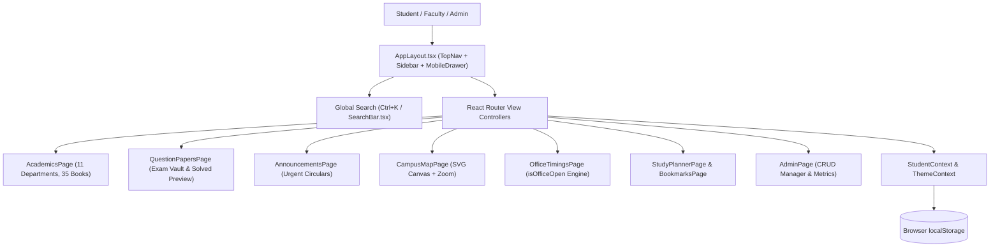

# 🎓 CAMPUSLY — Your Campus. Everything Connected.

> **Institutional Showcase:** Saint Oxford Institute of Technology (SOIT)  
> **Creative Direction:** *The Analog Campus — Digital, But Human*  
> **Status:** Production-Ready Web Application (TypeScript Strict, Vite 8, React 18, Tailwind CSS v4)

[](LICENSE)
[](https://www.typescriptlang.org/)
[](https://react.dev/)
[](https://tailwindcss.com/)
[](https://vitejs.dev/)

---

## 🏛️ 1. Project Overview

**Campusly** is a student-centric, unified collegiate web platform built for the students, faculty, and administration of **Saint Oxford Institute of Technology (SOIT)**. It unifies distributed college portals, syllabus PDFs, past examination archives, real-time circulars, campus navigation, and local amenities into one cohesive, editorial-grade digital experience.

Instead of navigating fragmented legacy ERP systems, scattered Google Drives, WhatsApp groups, and physical pin-boards, SOIT students have access to a single, beautifully designed command center that manages their academic journey, day-to-day schedule, exam preparations, and campus lifestyle.

---

## ❗ 2. Problem Statement

In modern higher education institutions, student information is painfully fragmented:
1. **Academic Fragmentation:** Syllabus sheets, textbook references, and lecture notes are passed unofficially through temporary WhatsApp groups or personal drives.
2. **Archival Inaccessibility:** Previous year question papers (PYQs) and solution schemes are difficult to source, often requiring visits to photocopy shops.
3. **Information Delay:** Crucial circulars regarding exam registrations, scholarships, and placement drives are easily missed on physical corkboards or buried in emails.
4. **Geographic & Operational Uncertainty:** Incoming students struggle to locate lecture halls, while seniors frequently walk across sprawling campuses only to find administrative offices closed for unannounced lunch breaks.
5. **Alienating User Experience:** Conventional college ERPs are designed for administrative record-keeping rather than student daily life.

---

## ✨ 3. Implemented Features

| Module | Route | Highlights |
| :--- | :--- | :--- |
| **Command Center** | `/` | Time-aware greeting, urgent circular ticker, today's lecture schedule, real-time open office counter, and quick-action cards. |
| **Academic Reading Room** | `/academics` | 11 engineering & basic science departments with full 4-year curricula and a 35-volume textbook library with cover artwork and ISBNs. |
| **Exam Vault** | `/question-papers` | 30+ multi-year question papers (2022–2025) across End-Sem, Mid-Sem, and Unit Tests with an interactive solved paper modal. |
| **Coursework & Practice** | `/assignments` | Coursework problem sets, lab manuals, and unit question banks with deadline countdowns and priority badges. |
| **Campus Noticeboard** | `/announcements` | 20 campus circulars with urgent animated pulses, pinned items, and category filters (Exam, Placement, Academic, Holiday). |
| **Interactive Campus Map** | `/campus-map` | Custom SVG vector layout of SOIT campus with drag-to-pan, zoom controls, and a building inspection drawer. |
| **Live Office Timings** | `/office-timings` | Dynamic client-side open/closed engine evaluating 16 college offices in real-time, accounting for lunch breaks. |
| **Around the Corner** | `/explore-nearby` | Curated directory of 30 student-friendly eateries, printing shops, transit stops, and pharmacies with walking distances. |
| **Freshers' Survival Guide** | `/freshers-guide` | 12 survival articles and an interactive 10-item onboarding checklist with `localStorage` persistence. |
| **Academic Calendar** | `/calendar` | Monthly milestone matrix tracking mid-terms, final exams, fee deadlines, fests, and holidays. |
| **Study Planner** | `/study-planner` | Personal task manager with priority filtering and radial progress visualization. |
| **Personal Shelf** | `/bookmarks` & `/downloads` | Saved textbooks, question papers, assignments, and simulated offline study downloads. |
| **Administrator Console** | `/admin` | CRUD interface for publishing notices, managing books, and reviewing institutional telemetry. |
| **Role Switcher** | Anywhere | 1-Click instant toggle between **Student Mode** (Atharv, EXTC Yr 2) and **Administrator Mode**. |

---

## 📸 4. Screenshots

*(See [ASSET_CHECKLIST.md](ASSET_CHECKLIST.md) for full asset specifications and capture instructions).*

```text
+-----------------------------------------------------------------------------------+
|                        CAMPUSLY DASHBOARD & COMMAND CENTER                         |
+-----------------------------------------------------------------------------------+
|  [01_dashboard_command_center.png]                                                |
|  * Personalized greeting, urgent banner, schedule strip, and quick access tiles   |
+-----------------------------------------------------------------------------------+
|               ACADEMIC READING ROOM              |          EXAM VAULT MODAL      |
+--------------------------------------------------+--------------------------------+
|  [02_academic_reading_room.png]                  |  [03_exam_vault_modal.png]      |
|  * 11 Departments, 4-Year Curricula & 35 Books    |  * Solved Question Paper Modal |
+--------------------------------------------------+--------------------------------+
|              INTERACTIVE SVG CAMPUS MAP          |       LIVE OFFICE TIMINGS      |
+--------------------------------------------------+--------------------------------+
|  [04_campus_vector_map.png]                      |  [05_live_office_timings.png]  |
|  * Vector Map with Zoom & Inspection Drawer       |  * Real-Time Open/Closed Logic |
+-----------------------------------------------------------------------------------+
```

---

## 🎨 5. Design System: "The Analog Campus"

Unlike generic corporate dashboards, Campusly introduces an **editorial visual language** inspired by classic university journals, physical corkboards, and archival reading rooms:
- **Warm Ivory (`#F6F1E7`) & Paper Cream (`#EDE4D4`):** Soft, paper-like background surfaces.
- **Deep Forest Green (`#183D32`):** Primary branding, active navigation, and section headers.
- **Muted Terracotta (`#C66B4E`):** Urgent circulars, exam tags, and warning alerts.
- **Academic Mustard (`#D7AA48`):** Deadlines, practical alerts, and secondary accents.
- **Sage Green (`#A8B9A0`) & Lavender (`#A9A0C2`):** Sports, hostels, and campus life tagging.
- **Typography Triad:**
  - *Headings:* `DM Serif Display` — Editorial academic gravitas.
  - *Body Text:* `DM Sans` — Clean, modern readability.
  - *Metadata:* `DM Mono` — Course codes, timestamps, and technical tags.

---

## 🛠️ 6. Technology Stack

- **Core Framework:** React 18 with TypeScript 5.8
- **Build Engine:** Vite 8 + Rolldown/Rollup optimizer
- **Styling:** Tailwind CSS v4 with custom CSS variable design tokens
- **Animations:** Framer Motion (page transitions, modals, drawers)
- **Icons:** Lucide React
- **Typography:** Google Fonts via `@fontsource`
- **Routing:** React Router v6 / v7
- **State Management:** React Context (`StudentContext`, `ThemeContext`)
- **Persistence:** HTML5 `localStorage`

---

## 📐 7. Architecture Overview



---

## 💻 8. Installation & Setup

### Prerequisites
- **Node.js:** v18.0.0 or higher
- **npm** (comes with Node.js)

### Installation Steps
1. Clone the repository:
   ```bash
   git clone https://github.com/your-username/campusly.git
   cd campusly
   ```
2. Install dependencies:
   ```bash
   npm install
   ```

---

## 🚀 9. Running Locally

Start the local development server:
```bash
npm run dev
```
Open **`http://localhost:5173`** in your browser to view the application live.

To stop the server, press `Ctrl + C` in your terminal.

---

## ⚙️ 10. Environment Variables

Campusly runs 100% standalone out-of-the-box without requiring any mandatory environment variables. For custom institutional deployments, copy `.env.example` to `.env`:
```bash
cp .env.example .env
```

| Variable | Default Value | Description |
| :--- | :--- | :--- |
| `VITE_APP_NAME` | `"Campusly"` | Platform display name |
| `VITE_APP_TAGLINE` | `"Your Campus. Everything Connected."` | Header slogan |
| `VITE_INSTITUTION_NAME` | `"Saint Oxford Institute of Technology (SOIT)"` | Collegiate entity |
| `VITE_ENABLE_TELEMETRY` | `false` | Optional analytics toggle |

---

## 📦 11. Production Build

To compile and bundle for production:
```bash
npm run build
```
* **Output Folder:** `dist/`
* **Test Bundle Locally:**
  ```bash
  npm run preview
  ```

---

## 🌐 12. Deployment Instructions

### Deploying to Render (Recommended)
1. Push your repository to GitHub.
2. Log into [Render.com](https://render.com) and click **New + → Static Site**.
3. Select your `campusly` repository.
4. Configure:
   - **Build Command:** `npm run build`
   - **Publish Directory:** `dist`
5. Click **Create Static Site**. Your site will be deployed at `https://campusly.onrender.com`.

### Deploying to Vercel
```bash
npx vercel
```
* Follow the CLI prompts with default settings (`Vite` framework preset).

### Deploying to Netlify
```bash
npx netlify deploy --prod --dir=dist
```

---

## 🔑 13. Demo Credentials & Evaluation

* **No Login Required:** To ensure frictionless testing, Campusly loads with a default verified student profile (**Atharv**, Electronics Engineering, Year 2, Sem III).
* **Administrator Mode:** Click the **Switch to Admin** button at the bottom of the sidebar or navigate to **Settings → Admin Dashboard** to evaluate administrative CRUD tools and circular publishing.

---

## ⚠️ 14. Demo Limitations

* **Simulated Academic Data:** Data records (35 textbooks, 30 question papers, 20 announcements) are pre-populated with realistic engineering curricula for demonstration.
* **Client-Side Persistence:** Bookmarks, study tasks, and checklist progress are stored in your browser's `localStorage` and will clear if browser cache is reset.
* **External ERPs:** External university biometric attendance systems and paid payment gateways are simulated client-side.

---

## 🔮 15. Future Scope

1. **SIS / ERP Biometric Sync:** Direct database connectors to college biometric turnstiles for live attendance metrics.
2. **Certified Student Uploads:** Peer-reviewed upload flow for student lecture notes and project reports.
3. **Progressive Web App (PWA):** Service worker offline caching for 100% offline timetable and syllabus viewing.
4. **Multi-Tenant Campus Federation:** Allowing any university to launch a white-label Campusly instance.

---

## 🤝 16. Contributing

We welcome community contributions! Please review our [CONTRIBUTING.md](CONTRIBUTING.md) for branch naming conventions, TypeScript standards, and pull request guidelines.

---

## 📜 17. License

Distributed under the **MIT License**. See [LICENSE](LICENSE) for full details.
